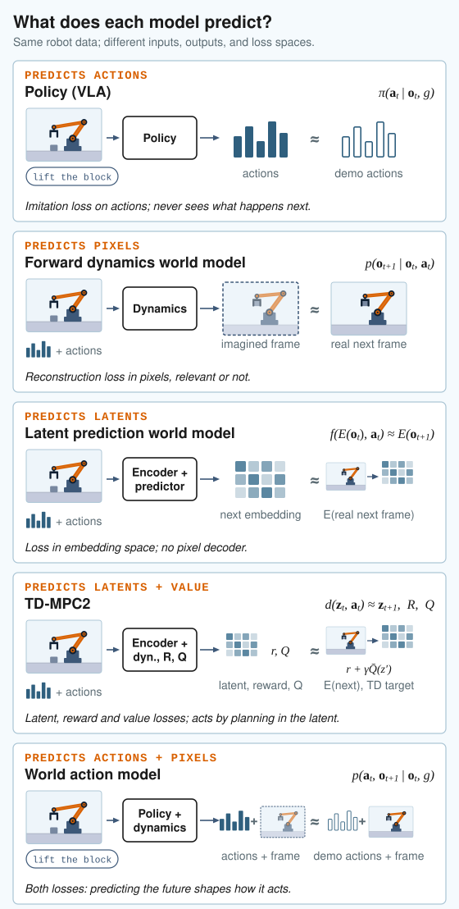

# Mini WM: small world models for robots

Minimal, readable reimplementations of the main kinds of robot foundation models and world models, each in one file,
trained on the same robot data ([LIBERO-90](https://libero-project.github.io/)) and evaluated in the same simulator. The
goal is to see, side by side, what each model predicts, how it learns and how it acts.

| Model | File | After |
|---|---|---|
| mini-FM, a policy trained by behaviour cloning, which the other models build on | [mini_fm.py](mini_fm.py) | Octo ([arXiv 2405.12213](https://arxiv.org/abs/2405.12213)), π0's action expert |
| mini-Dreamer, a world model in pixels, for imagination | [mini_dreamer.py](mini_dreamer.py) | DreamerV3, Dreamer 4 ([arXiv 2509.24527](https://arxiv.org/abs/2509.24527)) |
| mini-TD-MPC2, a world model that plans its actions | [mini_tdmpc2.py](mini_tdmpc2.py) | TD-MPC2 ([arXiv 2310.16828](https://arxiv.org/abs/2310.16828)) |
| mini-WAM, a world action model | [mini_wam.py](mini_wam.py) | Cosmos Policy ([arXiv 2601.16163](https://arxiv.org/abs/2601.16163)) |
| mini-JEPA, a latent world model | [mini_jepa.py](mini_jepa.py) | RoboJEPA ([arXiv 2610.10515](https://arxiv.org/abs/2610.10515)) |
| mini-VLAPS, tree search with a world model and a policy | [mini_vlaps.py](mini_vlaps.py) | VLAPS ([arXiv 2508.12211](https://arxiv.org/abs/2508.12211)) |
| RL fine-tuning of mini-FM with GRPO or PPO | [mini_fm_rl.py](mini_fm_rl.py) | GRPO, PPO |



**Start with the tutorial notebook, [mini_wm_tutorial.ipynb](mini_wm_tutorial.ipynb).** It goes through each model with
diagrams, builds it from its config, runs it on a real LIBERO-90 batch, and runs a pretrained mini-FM in the LIBERO-90 sim.

## Setup

You need Linux and an NVIDIA GPU (the LIBERO sim renders with EGL), and [uv](https://docs.astral.sh/uv/getting-started/installation/).
LIBERO is installed from a clone next to this repo:
```
git clone https://github.com/milarobotlearningcourse/mini-wm.git
git clone https://github.com/montrealrobotics/LIBERO.git   # next to mini-wm, as ../LIBERO
cd mini-wm
uv sync
```
The first run downloads the dataset from the Hugging Face Hub (about 600 MB). On its first import LIBERO would ask for
its data paths; `sim_eval.py` writes its default config (`~/.libero/config.yaml`) first, so it doesn't.

To run the notebook, pick the repo's `.venv` as the kernel in VS Code, or start Jupyter with
`uv run --with jupyterlab jupyter lab`.

## Training

Run from the repo root. Each model has its config in `conf/`:
```
MUJOCO_GL=egl uv run mini_train.py                            # mini-FM, conf/mini-fm.yaml
MUJOCO_GL=egl uv run mini_train.py --config-name mini-wam     # mini-WAM
MUJOCO_GL=egl uv run mini_train.py --config-name mini-dreamer # mini-Dreamer
MUJOCO_GL=egl uv run mini_train.py --config-name mini-jepa    # mini-JEPA
MUJOCO_GL=egl uv run mini_train.py --config-name mini-tdmpc2  # mini-TD-MPC2
MUJOCO_GL=egl uv run mini_train.py --config-name mini-fm-rl   # RL fine-tuning (GRPO; algorithm=ppo for PPO) of checkpoints/miniFM_libero90.pth
MUJOCO_GL=egl uv run mini_train.py --config-name mini-vlaps init_model=<run folder>/miniDreamer_best.pth  # mini-VLAPS: search, no training
```
- **Length:** a run is 25k steps at batch 512 (`max_iters`, `batch_size`), about 15-25 minutes of training on one
  GPU, with sim evals at 10k, 20k and 25k steps. Add `max_iters=500 sim.eval_interval=499` for a quick check.
- **Outputs:** each run gets its own folder, `outputs/<date>/<time>/`, with its log (`mini_train.log`), TensorBoard
  curves (`tensorboard --logdir outputs`), the rollout videos of its sim evals (`sim_eval/`), the predicted frames of
  the world models (`predicted_frames/`), the last model (`miniFM.pth`, `miniWAM.pth`, ...) and the model of the best
  sim eval (`miniFM_best.pth`, ...).
- **Overrides:** any config value can be changed on the command line, e.g. `model.action_head=diffusion` (π0's flow
  matching action head), `policy.use_pose_data=true` (give the policy the arm's joint positions) or
  `max_block_size=64` (keep 64 characters of each goal text instead of 16).
- **Memory:** the dataset is decoded once at startup and kept in RAM (about 14 GB for LIBERO-90 with two cameras).
  `dataset.cache=cuda` keeps it on the GPU instead, and `dataset.cache_episodes=500` keeps only 500 episodes at a
  time, swapping the others in from disk.
- **Sim evals:** in a background process on the CPU (`sim.background`, `sim.device`), so training doesn't wait. Each
  one runs 10 random LIBERO-90 tasks, one episode each (`conf/sim/default.yaml`).

**Weights & Biases.** Logging to wandb is off by default (`testing: true`). Turn it on with `testing=false`, after
`uv run wandb login`. Runs go to the project `experiment.project` (`mini-wm`) of `experiment.entity` (your default),
grouped by `experiment.name`: name each experiment after what it changes, e.g. `experiment.name=fm_diffusionhead`.

**Slurm.** [launch_slurm.sh](launch_slurm.sh) runs one job per seed, with wandb on. Adapt its `#SBATCH` lines to your cluster:
```
mkdir -p outputs/slurm
sbatch --array=1-2 --job-name=fm_chunk5_wristagentview launch_slurm.sh
sbatch --array=1-2 --job-name=wam_chunk5_wrist launch_slurm.sh --config-name mini-wam
```

## Tests

`tests/` holds short smoke runs of each model: a few hundred training steps on LIBERO spatial (a smaller download than
LIBERO-90), then one short sim episode, checking that the losses are finite and the outputs saved. They check that the
code runs, not that it learns.
```
uv run -m pytest tests/test_mini_fm_smoke.py -v -k fm_robot_smoke   # the quick check, about 2 min
uv run -m pytest tests/ -v                                          # all of them
```

## Files

- `mini_fm.py`, `mini_wam.py`, `mini_dreamer.py`, `mini_jepa.py`, `mini_tdmpc2.py`, `mini_vlaps.py`, `mini_fm_rl.py`: the models, one per file.
- `mini_train.py`: the training loop they all share (`model.type` picks the model).
- `data_loading.py`: reads the LeRobot datasets (parquet and MP4 files) without the lerobot library, and samples batches from a cache of decoded trajectories.
- `sim_eval.py`: batched rollouts in the LIBERO sim, for the sim evals and RL fine-tuning.
- `logger.py`: TensorBoard and wandb.
- `conf/`: the configs (hydra). `docs/`: the notebook's diagrams.
- `checkpoints/miniFM_libero90.pth`: a mini-FM trained on LIBERO-90 for 25k steps, for the notebook and RL fine-tuning.

The data is [gberseth/libero_90_no_noops_lerobot](https://huggingface.co/datasets/gberseth/libero_90_no_noops_lerobot):
LIBERO-90's 3,933 demonstrations (90 tasks, 20 Hz) re-rendered without their no-op actions, with a wrist and an
agent-view camera. Its actions are the end effector's delta position, delta rotation (axis-angle) and gripper.
Another LIBERO suite works the same way, e.g. `dataset.robot_dataset_name=[gberseth/libero_spatial_no_noops_lerobot] sim.task_sets=[libero_spatial]`.

## License

MIT
